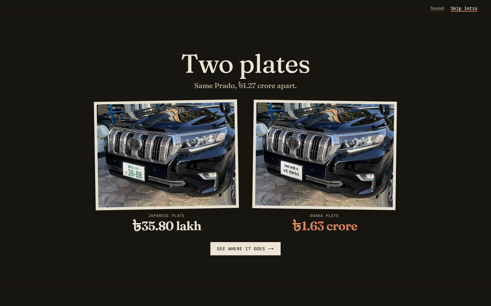
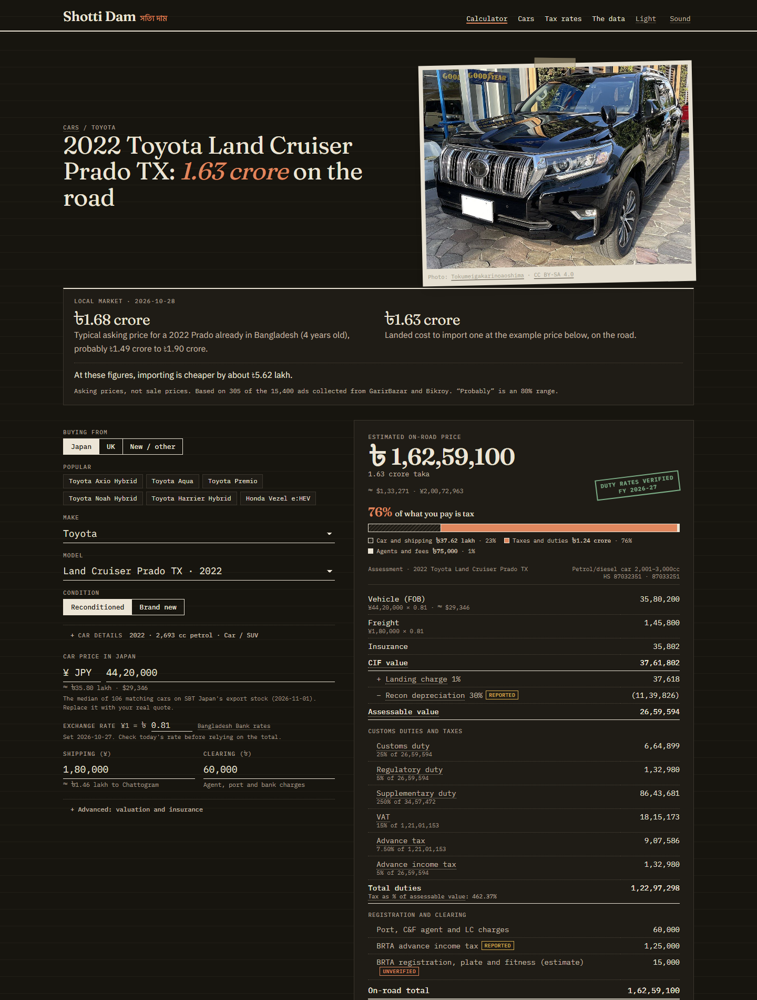
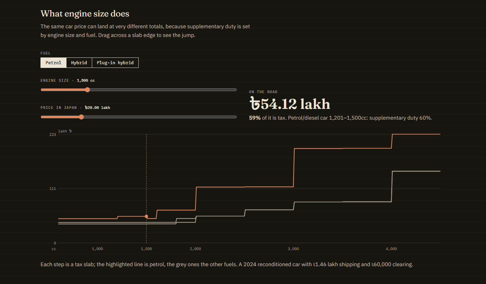
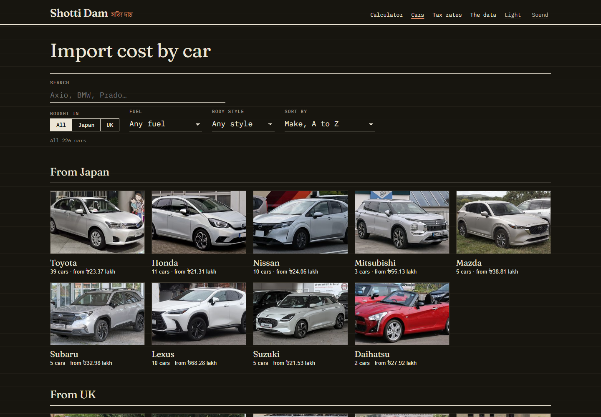
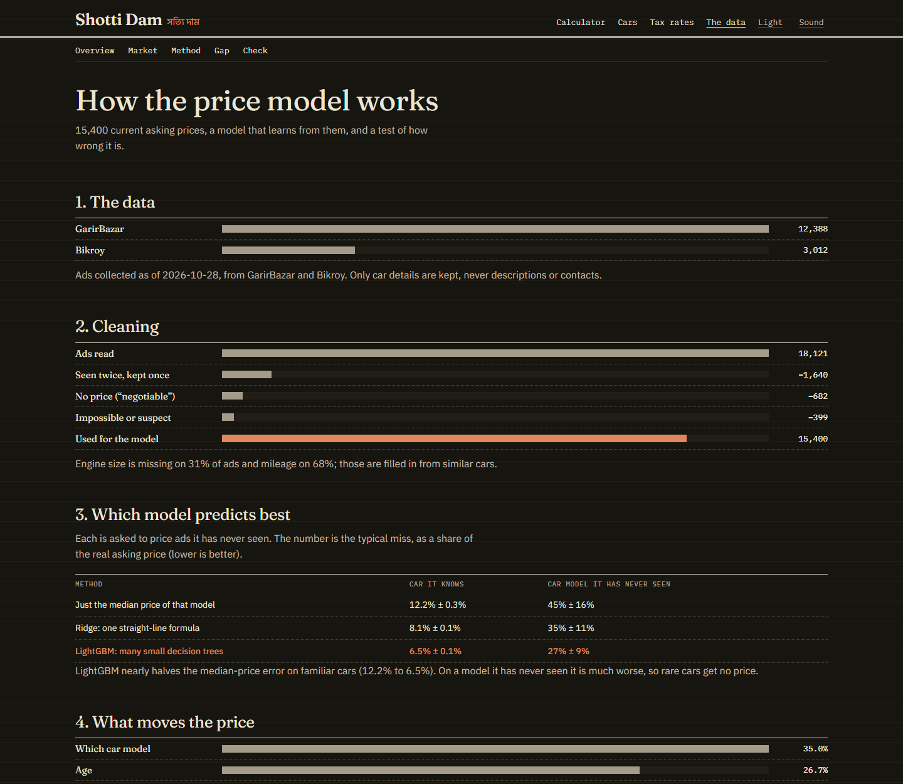
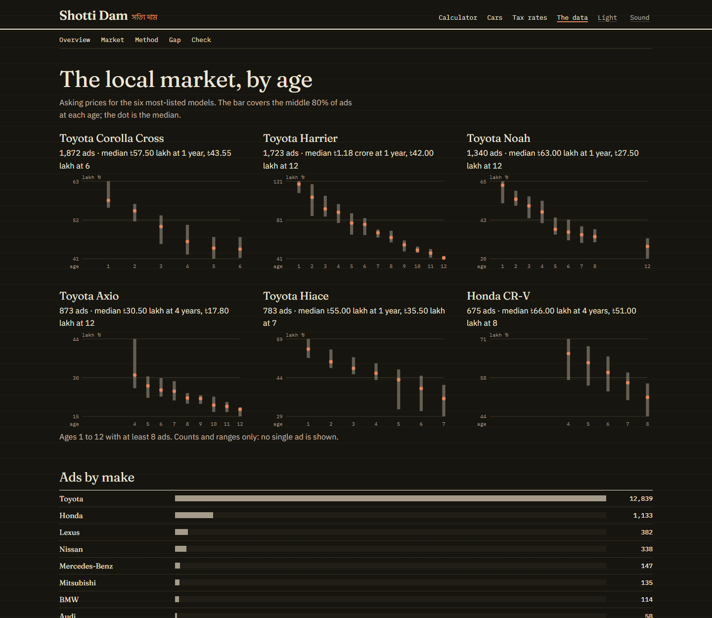
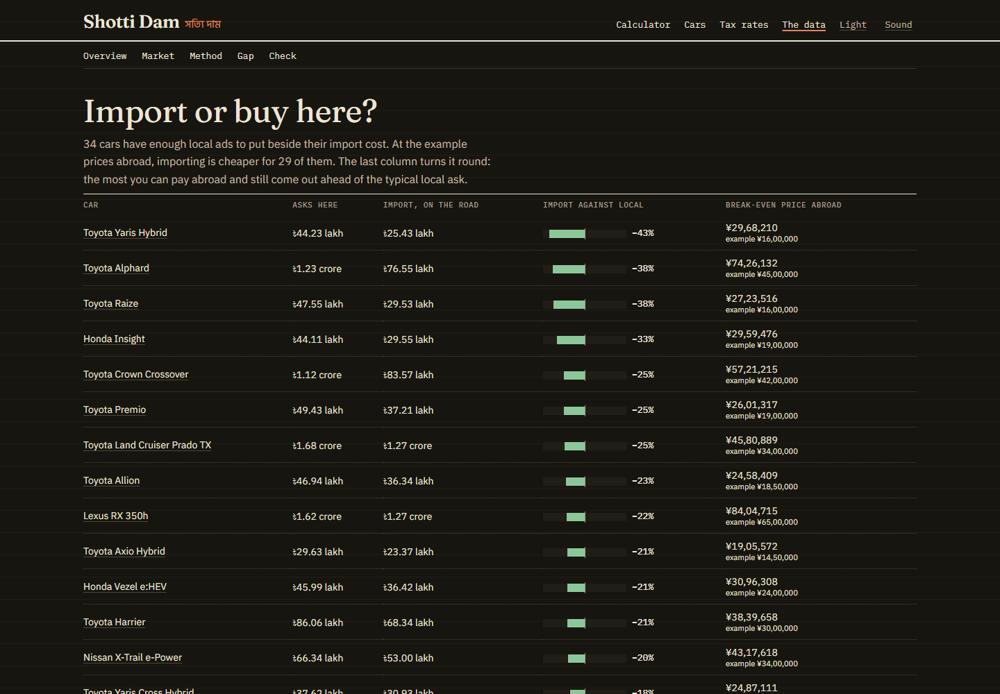
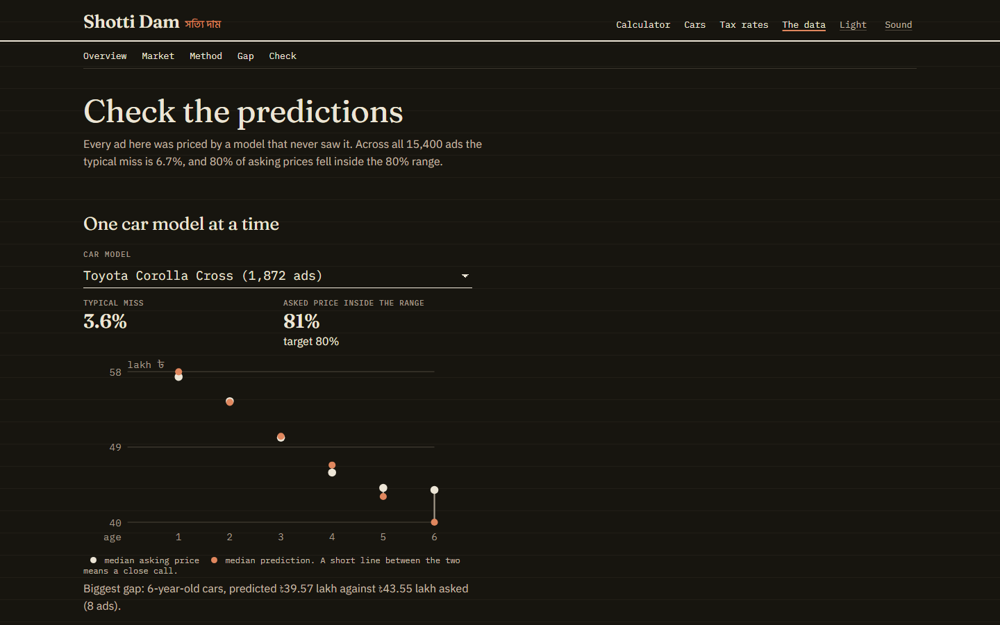

# Shotti Dam (সত্যি দাম)

A transparent car price site for Bangladesh: what a car actually costs to import from Japan or the UK, with every customs duty, fee and source itemised.

**Live:** https://hal0mg.github.io/bd-car-prices/

**Write-up:** [how it works and what the model found](docs/WRITEUP.md)



## What it does

**Calculator.** Pick a car, enter the price abroad, and see every customs duty, fee and tax line by line, with how much of the total is tax. Where the local market has enough ads, it also shows what the same car typically asks in Bangladesh.



**Tax rates.** Every duty slab with its HS code, and a chart of what engine size and fuel do to the on-road price. Every term on the calculator's breakdown has a plain-English note on hover or tap.



**Cars.** 226 cars bought from Japan or the UK, with the import cost of each.



**The data.** The offline price model behind the local-market figures, with its error and its limits shown rather than hidden.









## Layout

- `web/` — Next.js site and the tax engine
  - `src/lib/tax/` — rate tables and the duty cascade (`engine.ts`), tested against the NBR tariff's printed totals
  - `src/lib/market.ts` — car catalogue, exchange rates and freight defaults
- `ml/` — Python price model: a polite collector for current listings, and models with cross-validation and adaptive prediction intervals, validated on 15,400 current listings and a 2021 file (see `ml/README.md` and the one-page `ml/MODEL_CARD.md`). Its results are shown on the site under "The data" (Market, Method, Check)
- `design-demos/` — the three style directions explored before building

## Running

```bash
cd web
npm install
npm run dev
```

`npm test` runs the tax engine tests. Don't run `npm run build` while the dev server is running; both write to `.next/`.

## Rates

Duty rates come from the NBR Customs Tariff 2026-27 (chapter 87, heading 8703, the 11 June 2026 version). Recon depreciation, the import age limit and BRTA advance income tax aren't in the tariff; they follow figures that several news and industry sources agree on and are marked "reported". Other BRTA fees are an estimate. Every figure carries one of four confidence labels (verified, derived, reported, unverified); see `src/lib/tax/types.ts`.

## Car photos and model years

Car photos are free-licensed images from Wikimedia Commons, copied into `web/public/cars` in three widths by `web/scripts/localize_photos.py` (run it after adding a car to `photos.ts`; it only fetches new ones). Credits stay on every page. The catalogue's model years are fixed, so roll them forward each January: customs allows reconditioned cars up to five years old, counted from 1 January after the model year, and car pages warn when one passes the limit.
