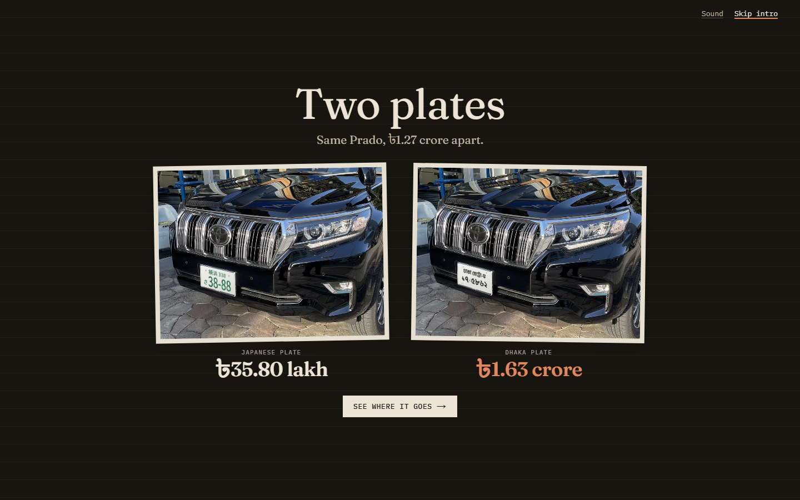
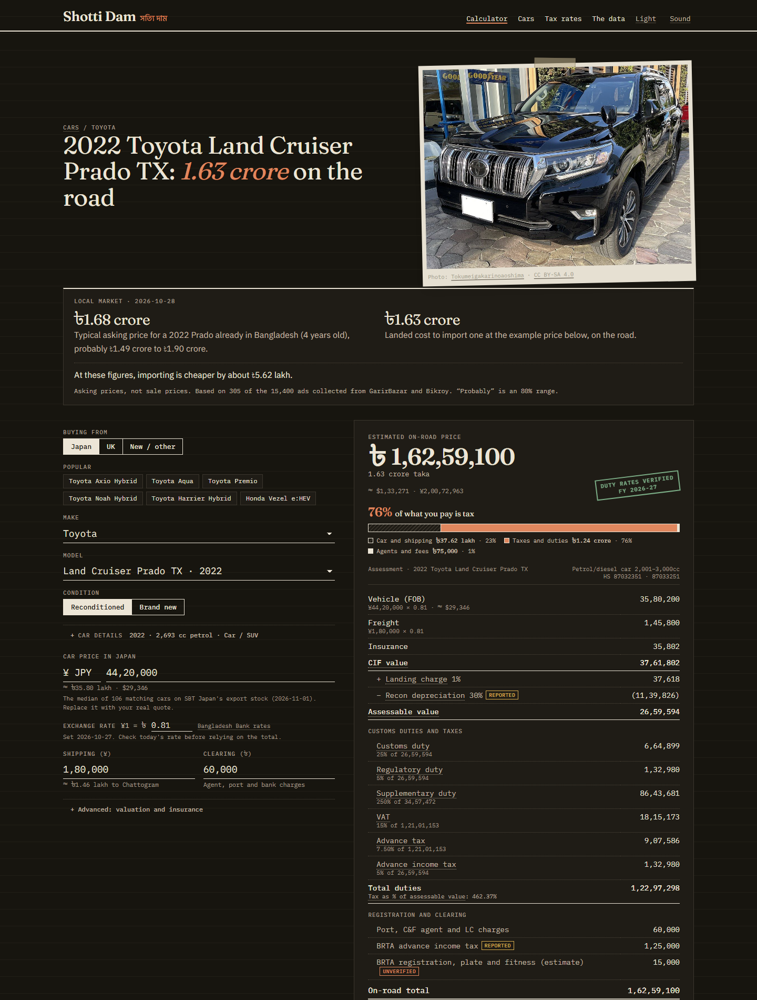
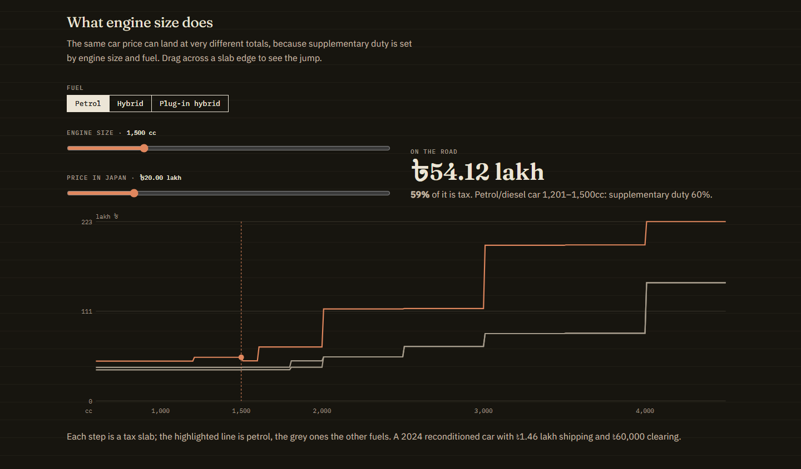
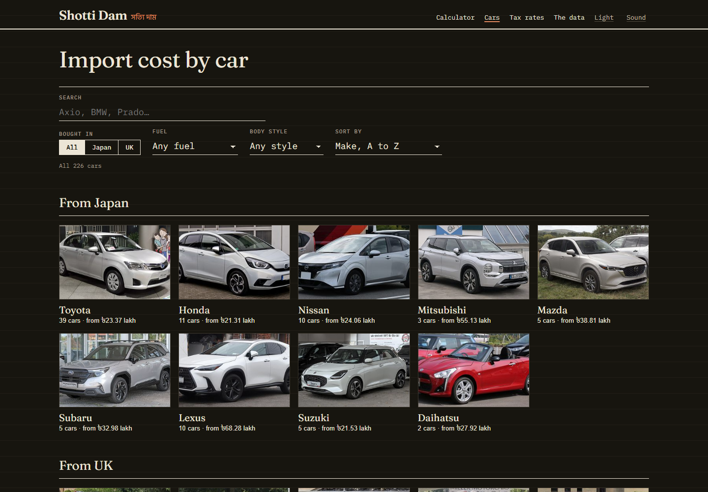
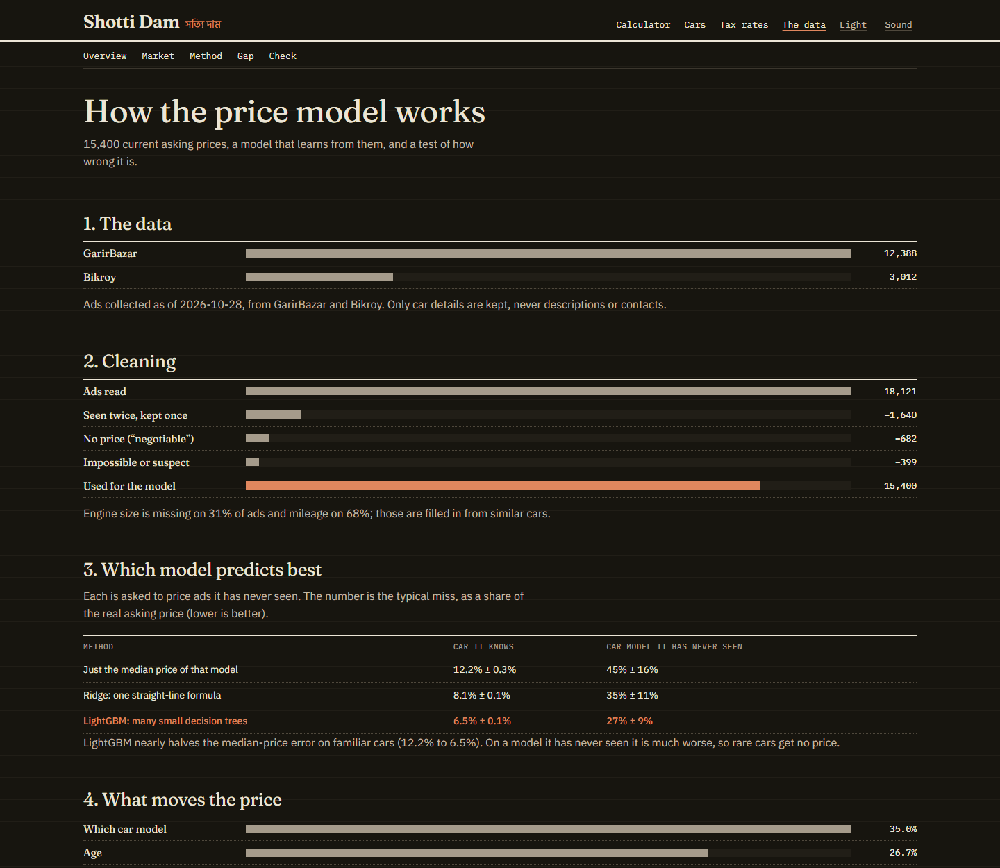
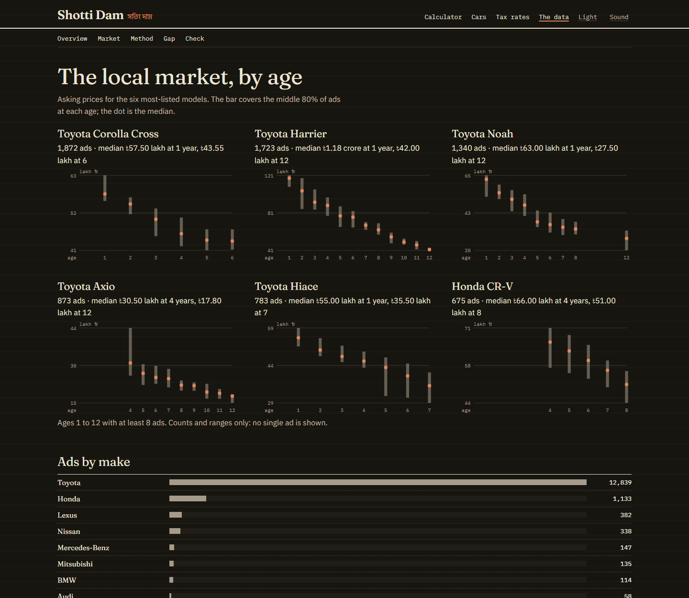
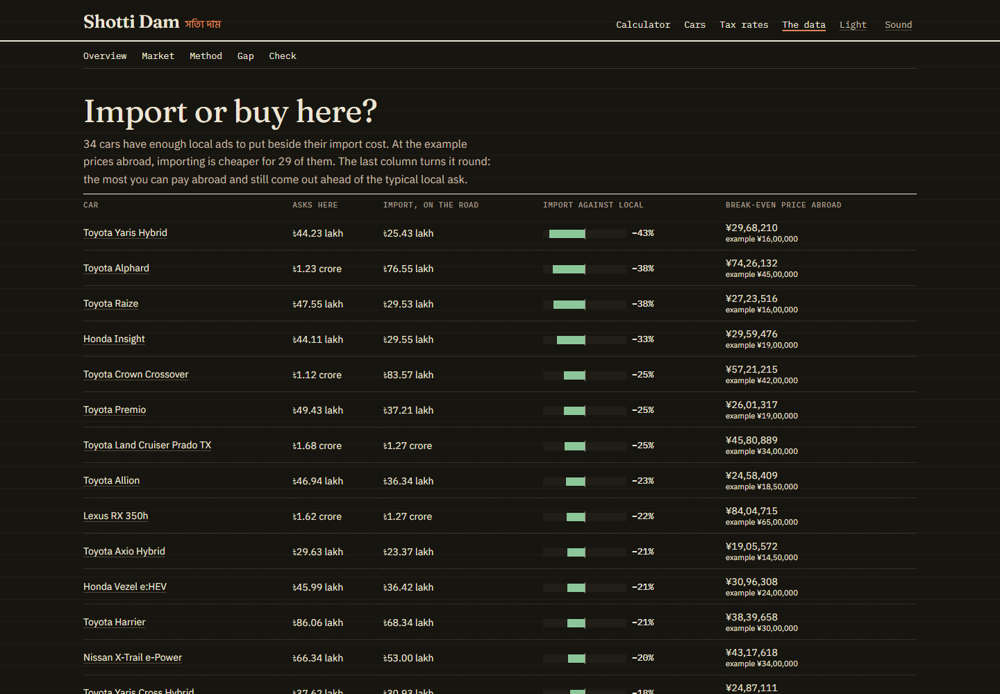
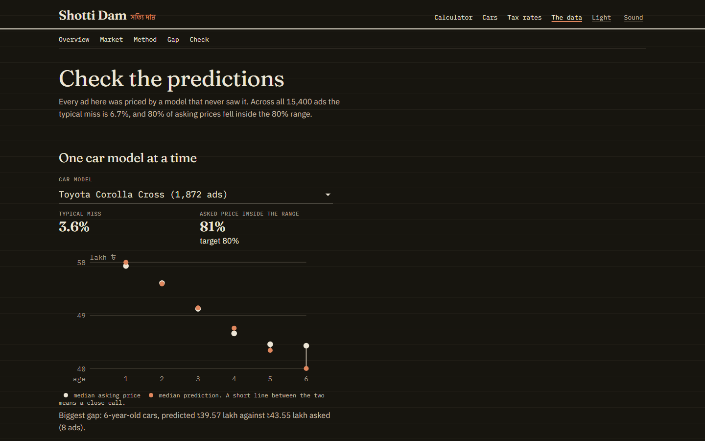

# Shotti Dam (সত্যি দাম)

[](https://github.com/Hal0MG/bd-car-prices/actions/workflows/ml.yml)

A transparent car price site for Bangladesh: what a car actually costs to import from Japan or the UK, with every customs duty, fee and source itemised. Behind it is a used-car price model that is also served as an API, tracked, and checked for drift.

**Live:** https://hal0mg.github.io/bd-car-prices/

**Write-up:** [how it works and what the model found](docs/WRITEUP.md)



## What it does

**Calculator.** Pick a car, enter the price abroad, and see every customs duty, fee and tax line by line, with how much of the total is tax. Where the local market has enough ads, it also shows what the same car typically asks in Bangladesh.



**Tax rates.** Every duty slab with its HS code, and a chart of what engine size and fuel do to the on-road price. Every term on the calculator's breakdown has a plain-English note on hover or tap.



**Cars.** 354 cars bought from Japan or the UK, with the import cost of each.



**The data.** The offline price model behind the local-market figures, with its error and its limits shown rather than hidden.









**Chinese cars.** Chinese cars are sold new here, so they sit outside the import calculator. Its own tab, The Chinese dilemma, tells it as a story: how the new-car duty on electric and plug-in cars steps up with value (checked against the 64%, 80% and 73.44% the budget coverage quotes) and works back from BYD showroom prices to how much of each is tax.

## The price model in production

The model behind "The data" is not only a notebook result. It is trained, served and watched like a production model ([ml/README.md](ml/README.md#serving-and-monitoring) has every command and detail).

| Piece | What it does |
|---|---|
| **Versioned training** (`python -m shotti_ml.train`) | Fits the same LightGBM model and 80% range the site uses, saves a versioned artifact (models as text, metrics, the git commit it came from) and logs each run to **MLflow** |
| **Price API** (`shotti_ml.api`, **FastAPI**) | `POST /predict` prices one car with its 80% range; `GET /health`, `GET /model`. Bad input gets a 422 that names the field |
| **Drift check** (`python -m shotti_ml.drift`) | Compares new listings with the training data (PSI on numbers, share shifts on categories) and, when prices are known, live error and range coverage. Exits non-zero past set thresholds |
| **CI** ([ml.yml](.github/workflows/ml.yml)) | On every change to `ml/`: runs the tests, trains a small model on made-up listings, builds the **Docker** image and calls the running container |

Results from the artifact trained on 22 November 2026:

- **6.5% median error** on 3,850 held-back cars, and 6.5 ± 0.1% in 5-fold cross-validation repeated 3 times. **80.1%** of real prices fall inside the 80% range.
- The saved model reproduces all 34 prices on the site exactly.
- `/predict` for a 2018 Toyota Axio 1500cc at 60,000 km: **৳22.5 lakh** (range ৳19.7 to 25.8 lakh). The ten such Axios listed have a median of ৳21.8 lakh, and 8 of them fall inside the range.
- **The drift check catches a real shift.** A model trained only on GarirBazar, checked on 3,019 Bikroy listings: error rises from 6.4% to 9.4%, range coverage falls from 80% to 63%, and the check fails with 10 alerts.
- **152 tests**, run in CI along with the image build.

## Layout

- `web/` — Next.js site and the tax engine
  - `src/lib/tax/` — rate tables and the duty cascade (`engine.ts`), tested against the NBR tariff's printed totals
  - `src/lib/market.ts` — car catalogue, exchange rates and freight defaults
- `ml/` — Python price model: a polite collector for current listings, and models with cross-validation and adaptive prediction intervals, validated on 15,400 current listings and a 2021 file (see `ml/README.md` and the one-page `ml/MODEL_CARD.md`). Its results are shown on the site under "The data" (Market, Method, Check)
  - `src/shotti_ml/train.py`, `api.py`, `drift.py` — versioned training with MLflow, the FastAPI service, the drift check
  - `Dockerfile` — the price API as a container (built and smoke-tested in CI)
- `design-demos/` — the three style directions explored before building

## Running

```bash
cd web
npm install
npm run dev
```

`npm test` runs the tax engine tests. Don't run `npm run build` while the dev server is running; both write to `.next/`.

The price API:

```bash
cd ml
python -m venv .venv
.venv/Scripts/python.exe -m pip install -e ".[dev,api,mlops]"
.venv/Scripts/python.exe -I -m shotti_ml.train            # needs the listings in ml/data/raw
.venv/Scripts/python.exe -m uvicorn shotti_ml.api:app --port 8000
.venv/Scripts/python.exe -m pytest                         # 152 tests, no listings needed
```

## Rates

Duty rates come from the NBR Customs Tariff 2026-27 (chapter 87, heading 8703, the 11 June 2026 version). Recon depreciation, the import age limit and BRTA advance income tax aren't in the tariff; they follow figures that several news and industry sources agree on and are marked "reported". Other BRTA fees are an estimate. Every figure carries one of four confidence labels (verified, derived, reported, unverified); see `src/lib/tax/types.ts`.

## Car photos and model years

Car photos are free-licensed images from Wikimedia Commons, copied into `web/public/cars` in three widths by `web/scripts/localize_photos.py` (run it after adding a car to `photos.ts`; it only fetches new ones). Credits stay on every page. The catalogue's model years are fixed, so roll them forward each January: customs allows reconditioned cars up to five years old, counted from 1 January after the model year, and car pages warn when one passes the limit.
