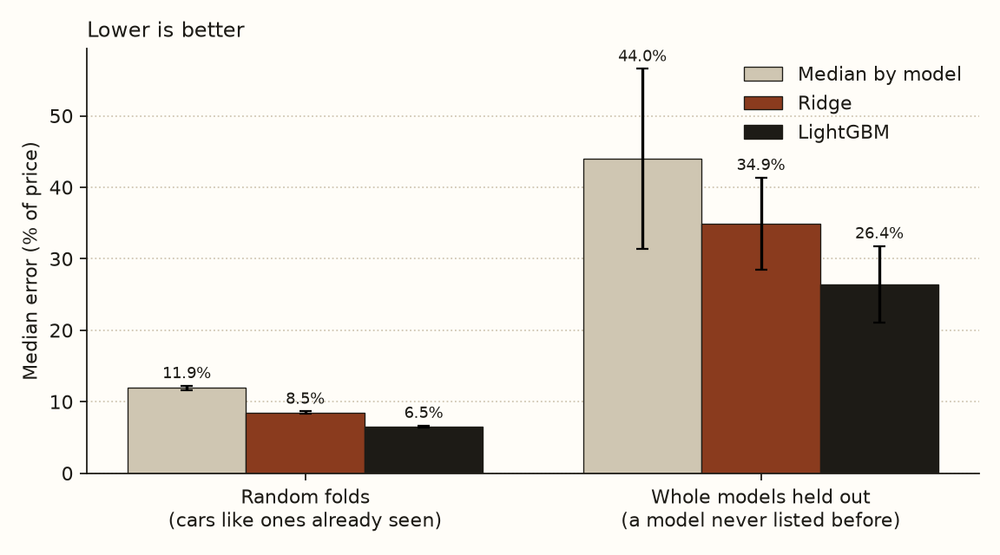
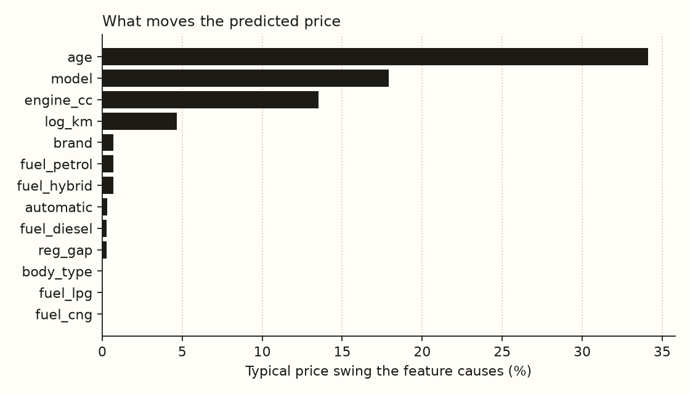
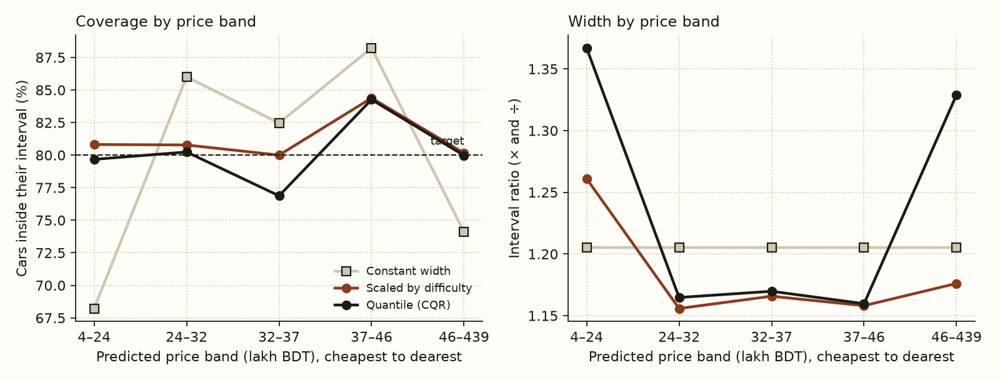
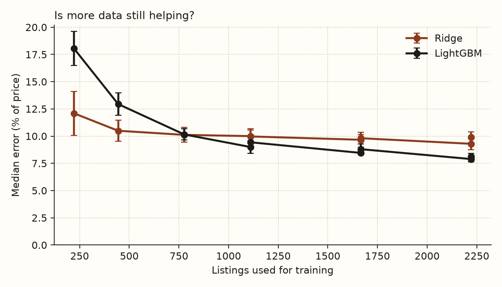

# Used-car price model

Can the asking price of a used car in Bangladesh be predicted from its age, model and engine, and how far can the prediction be trusted?

This project answers that on **2,777 current listings** (collected October 2026) and checks the method against an older **2021 file of 1,200 listings**. It compares three models, tests them two ways, and puts an honest interval around every prediction.

## Results on current listings

Errors are the median of |predicted − actual| / actual, mean ± standard deviation over 15 folds (5-fold, repeated 3 times). Lower is better.

| Model | Cars like ones already seen | A model never listed before |
|---|---|---|
| Median price of that model | 12.6 ± 1.0% | 34.1 ± 10.7% |
| Ridge regression | 9.6 ± 0.6% | **21.3 ± 7.3%** |
| LightGBM | **8.0 ± 0.3%** | 23.7 ± 7.4% |



- **LightGBM prices familiar cars to within about 8%** (an average miss of ৳5.6 lakh), against 12.6% for quoting the model's median price.
- **For a model it has never seen, the simpler ridge model is a little better** (21.3% against 23.7%). Gradient boosting leans on the model name, which tells it nothing about a new one. A site built on this should fall back to ridge for models with no listings.
- **Age dominates.** Age moves the predicted price by about 34% on average, car model by 18%, engine size by 14%, mileage by 5%. Everything else, including fuel and gearbox, is under 1%.



### How far to trust a price

Each prediction comes with an 80% interval, built by split conformal prediction. Three ways of setting its width were scored on the same held-out cars:

| Method | Coverage | Median width (× and ÷) |
|---|---|---|
| Constant width | 79.8 ± 2.2% | 1.21 |
| Quantile regression (CQR) | 80.2 ± 2.0% | 1.19 |
| **Scaled by difficulty** | **81.2 ± 1.6%** | **1.17** |

All three hit 80% overall, but a constant width does it by being too narrow for cheap cars and the dearest ones: it covers only **68%** of cars under ৳24 lakh and **74%** of those over ৳46 lakh. Scaling the width by how hard the car is to price holds about 80% in every price band, with the narrowest intervals overall. It is the method to use.



### More data still helps

LightGBM overtakes ridge at about 800 training listings and is still improving at 2,200 (7.9%), while ridge has flattened near 9.3%. Weekly snapshots would keep paying off.



## Prices since 2021

Median asking price of cars five to ten years old, same model, in the 2021 file and now. Comparing cars of equal age keeps it fair: a car that was five years old in 2021 is ten now.

| Model | Cars (2021 / now) | Median 2021 | Median now | Change |
|---|---|---|---|---|
| Axio | 79 / 222 | ৳15.2 lakh | ৳24.5 lakh | +61% |
| Noah | 31 / 174 | ৳25.0 lakh | ৳35.0 lakh | +40% |
| Premio | 64 / 130 | ৳21.5 lakh | ৳44.8 lakh | +108% |
| Prius | 14 / 99 | ৳26.1 lakh | ৳31.8 lakh | +22% |
| Harrier | 14 / 91 | ৳54.5 lakh | ৳73.5 lakh | +35% |

The full table is in [reports/current/baseline_report.md](reports/current/baseline_report.md). Read it as a rough size of the move, not a measurement: the two files come from different websites, with different mixes of dealers and private sellers.

## The 2021 file, as a check

The method was first built and validated on [Bikroy listings from 2021](reports/baseline_report.md) (1,200 cars, median build year 2011). It gives the same picture: LightGBM at 8.4% on familiar cars and 18.2% on unseen models, and a constant-width interval that covers only 65% of the cheapest cars. That the results hold on two sites, five years apart, is the best evidence that they reflect the method and not an accident of one dataset.

## How the listings were collected

The collector (`src/shotti_ml/collect/`) is gentle by construction, not by promise:

- It reads `robots.txt` first and refuses any path the site disallows.
- It waits at least three seconds between requests (the code refuses less than two), backs off when told to slow down, and stops after three failures in a row.
- It fetches a listing page, which holds about 20 cars, rather than opening every ad, and samples random pages so the snapshot spans old and new ads.
- It keeps car attributes only: make, model, year, price, mileage, engine, fuel, gearbox, city and when the ad was posted. It reads the description for the registration year and throws the rest away, because sellers put phone numbers and emails in it. A test checks that none survives.
- Raw snapshots stay in `data/raw/`, which git ignores. Only code, tests and aggregate results are published, never the listings.

Two runs gathered 3,000 listings in 154 requests, with no failures. GarirBazar's terms grant "personal, non-commercial viewing" and don't mention automated access. GarirBazar has approved the collection. `scripts/weekly_collect.ps1` takes a 100-page snapshot with a different page sample each week, meant to run from Windows Task Scheduler on Sundays; the draft request is kept in [docs/garirbazar-permission.md](docs/garirbazar-permission.md).

## On the site

`export.py` fits LightGBM once, sets the width with the "scaled by difficulty" method, and writes an expected price and 80% range for each catalogue car to `web/src/lib/local-prices.json`. Car pages show it beside the import cost. The site runs no Python.

A catalogue car gets a price only when its model has at least five current listings and at least three were built within a year of its model year; that is 29 of the 114 cars, almost all Toyotas. The rest show a note saying why there is no figure. Each car is predicted with its model's typical engine size and its listings' typical mileage, since cards report engine size in rough classes (mostly 1000 or 2000cc). Models without enough listings are left out, not guessed with the weaker ridge fallback.

```bash
.venv/Scripts/python.exe -I -m shotti_ml.export
```

## What was done

1. **Cleaning** (`current.py`), every change counted: 40 ads seen twice kept once (latest sighting), 137 with no price ("NEGOTIABLE") dropped, 22 impossible years and prices dropped, 23 price outliers dropped (below a quarter or above four times comparable cars), engine size filled in from the model's median for 18% of cars and mileage for 63%.
2. **Features** (`features.py`). Age, log mileage, engine size, gearbox, fuel flags, brand and model, with rare ones pooled using counts of features only.
3. **Target.** The log of the price, so errors are relative.
4. **Models** (`models.py`). The median by model, ridge regression, and LightGBM with modest capacity.
5. **Evaluation** (`evaluate.py`, `intervals.py`). Repeated 5-fold cross-validation, run two ways: random folds, and folds holding out whole car models. Intervals use the same folds for every method.

## Limits

- **One day of data.** Both snapshots were taken on 28 October 2026. Prices drift, so weekly snapshots are needed to see that, and to tell a slow-selling overpriced car from a fair one.
- **Asking prices, not sale prices.** Sellers ask more than buyers pay, and the gap is unknown. The site's report-a-price form is meant to measure it.
- **Cards leave out useful facts.** They never show body style or whether a car is used or reconditioned, and omit mileage on 63% of ads, so mileage barely helps the model.
- **Narrow market.** 89% of listings are Toyotas and 41 of 139 models have five or more listings. The model is best for the common ones.
- **Random-fold results are optimistic.** Near-identical listings can sit on both sides of a split, which is why the held-out column matters more.
- **The 2021 comparison crosses two websites.** See above.

## Next

1. Run the collector weekly, then study how long ads stay up and how asking prices fall.
2. Widen the export beyond the 29 cars it covers today (see below), once more models have enough listings.
3. Compare local prices with import cost once there is a source of Japan auction prices.

## Run it

```bash
cd ml
py -m venv .venv
.venv/Scripts/python.exe -m pip install -e ".[dev]"
.venv/Scripts/python.exe -m pytest

# the 2021 file
.venv/Scripts/python.exe scripts/download_data.py        # downloads and checks the dataset's hash
.venv/Scripts/python.exe -I -m shotti_ml.run_baseline    # about 2 minutes

# current listings
.venv/Scripts/python.exe -I -m shotti_ml.collect.run --pages 40   # about 4 minutes, one page every 3 seconds
.venv/Scripts/python.exe -I -m shotti_ml.run_current              # about 3 minutes
```

On macOS or Linux, use `.venv/bin/python` instead. Results go to `reports/` and `reports/current/`.

## Data

- Current listings: GarirBazar's public listing pages, collected as above. Not redistributed.
- 2021 file: Amik, F. R., Momen, S. and Lanard, A. (2024). *Car Dataset: Used cars data from Bikroy.com*, version 2. Mendeley Data, [doi:10.17632/fmb4xmp4k5.2](https://data.mendeley.com/datasets/fmb4xmp4k5). Licensed CC BY 4.0.
