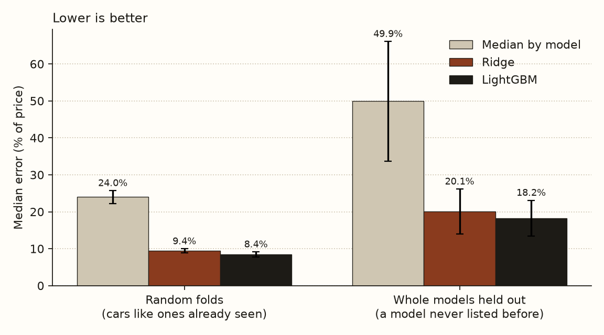
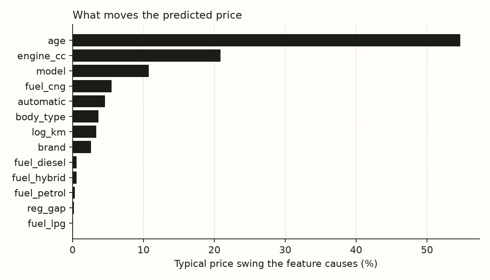
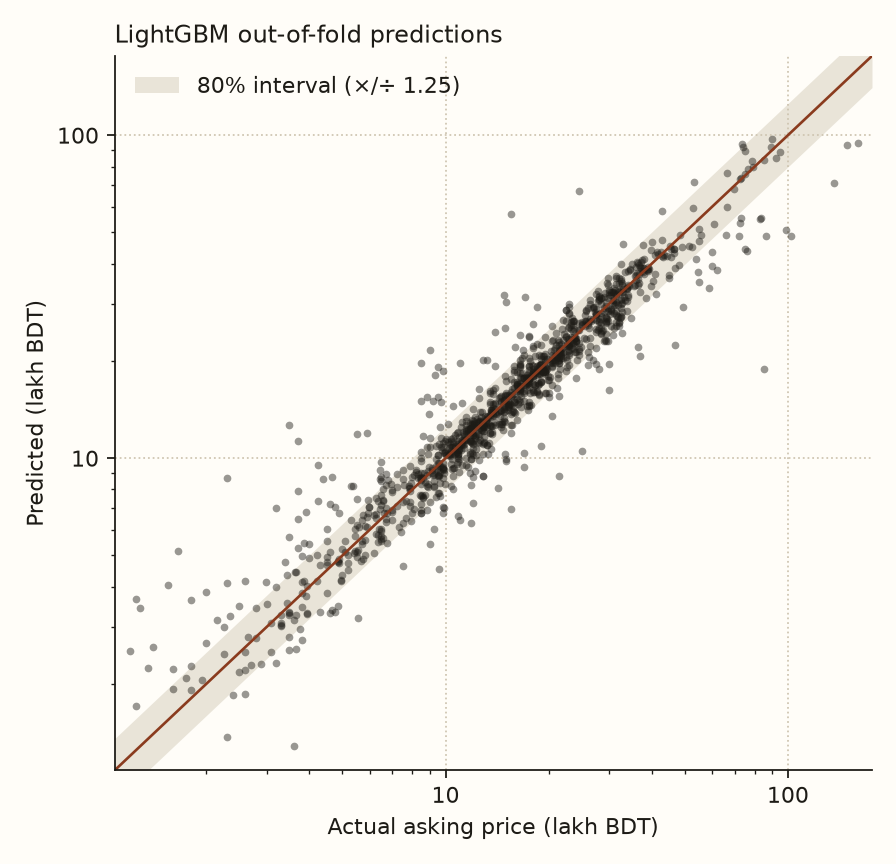

# Used-car price model: baseline

Can an asking price for a used car in Bangladesh be predicted from its age, engine, mileage and model, and how far can the prediction be trusted?

This baseline answers that on 1,200 Bikroy listings. It compares three models, tests them two ways, and puts an honest interval around each prediction.

## Results

Errors are the median of |predicted − actual| / actual, mean ± standard deviation over 15 folds (5-fold, repeated 3 times). Lower is better.

| Model | Cars like ones already seen | A model never listed before |
|---|---|---|
| Median price of that model | 24.0 ± 1.7% | 49.9 ± 16.2% |
| Ridge regression | 9.4 ± 0.5% | 20.1 ± 6.1% |
| **LightGBM** | **8.4 ± 0.7%** | **18.2 ± 4.9%** |



- **The model beats the dealer's rule of thumb by a wide margin.** Quoting the median price for a model is wrong by about a quarter. LightGBM cuts that to about 8%, with mean absolute error 2.7 lakh BDT.
- **The held-out column is the conservative number.** Random folds let the model see other listings of the same model, as it would for a Premio or an Axio. Holding out whole models tests a car it has never met, and the error roughly doubles.
- **Age dominates.** Age moves the predicted price by about 55% on average, engine size by 21%, car model by 11%, CNG conversion by 5%. Mileage matters little (3%), probably because seller-entered mileage is unreliable.



### Prediction intervals

Split conformal prediction gives an interval of the prediction ÷ and × 1.25. Aiming for 80% coverage, it covered **80.7% ± 4.0%** of cars it had not seen.



The coverage is right on average but not everywhere. The band has the same relative width at every price, while the scatter shows cheap cars (under 5 lakh) are predicted worse than mid-range ones, so the interval is too narrow there.

## What was done

1. **Cleaning** (`src/shotti_ml/data.py`). Every change is counted in the report:
   - 9 re-posts dropped: the same car, year, mileage and price under a different title, which would leak across folds.
   - Build year taken from the listing title. `model_year` differs for 65 listings and looks like a later registration year.
   - 2 engine-size typos (150cc for 1500cc) replaced with the median for that model.
   - 5 mileages above 400,000 km capped (a 2016 Prius at 900,000 km).
   - 24 messy fuel strings such as "CNG, Octane" split into yes/no flags.
2. **Features** (`features.py`). Age, log mileage, engine size, transmission, fuel flags, plus brand, model and body type, with rare brands and models pooled. Counts use features only, never the price.
3. **Target.** The log of the price, so errors are relative and one very expensive Land Cruiser doesn't dominate.
4. **Models** (`models.py`). The median by model (a baseline any model must beat), ridge regression, and LightGBM with modest capacity because there are only about 1,200 rows.
5. **Evaluation** (`evaluate.py`). Repeated 5-fold cross-validation, run two ways: random folds, and folds that hold out whole car models together.

## Limits

- **The prices are from November 2021.** The file's date and its newest model year (2021) say so. They are five years and one currency devaluation old, so this model shows the method works, but it cannot price a car today.
- **Most cars here are older than the site's.** The median build year is 2011, and nothing is newer than 2021. The site's catalogue (2021–2023 recon imports) lies mostly outside what this model has seen.
- **These are asking prices.** Sellers ask more than buyers pay, and the gap is unknown.
- **The data is narrow.** 81% of listings are Toyotas, and 83 of 123 models have fewer than five listings.
- **Random-fold results are optimistic.** Near-identical listings can sit on both sides of a split, which is why the held-out figures matter more.

## Next

1. Collect current listings (CarDekho BD and GarirBazar both allow listing pages in robots.txt; their terms need checking first), saving car attributes and prices only, weekly.
2. Make intervals adaptive so cheap cars get wider ranges (conformalized quantile regression).
3. Compare local prices with import cost once there is a source of Japan auction prices.
4. Export the model so car pages on the site can show an expected local price.

## Run it

```bash
cd ml
py -m venv .venv
.venv/Scripts/python.exe -m pip install -e ".[dev]"
.venv/Scripts/python.exe scripts/download_data.py        # downloads and checks the dataset's hash
.venv/Scripts/python.exe -I -m shotti_ml.run_baseline    # about 20 seconds
.venv/Scripts/python.exe -m pytest
```

On macOS or Linux, use `.venv/bin/python` instead. Results are written to `reports/`.

## Data

Amik, F. R., Momen, S. and Lanard, A. (2024). *Car Dataset: Used cars data from Bikroy.com*, version 2. Mendeley Data, [doi:10.17632/fmb4xmp4k5.2](https://data.mendeley.com/datasets/fmb4xmp4k5). Licensed CC BY 4.0. The listings are scraped from Bikroy.com.
